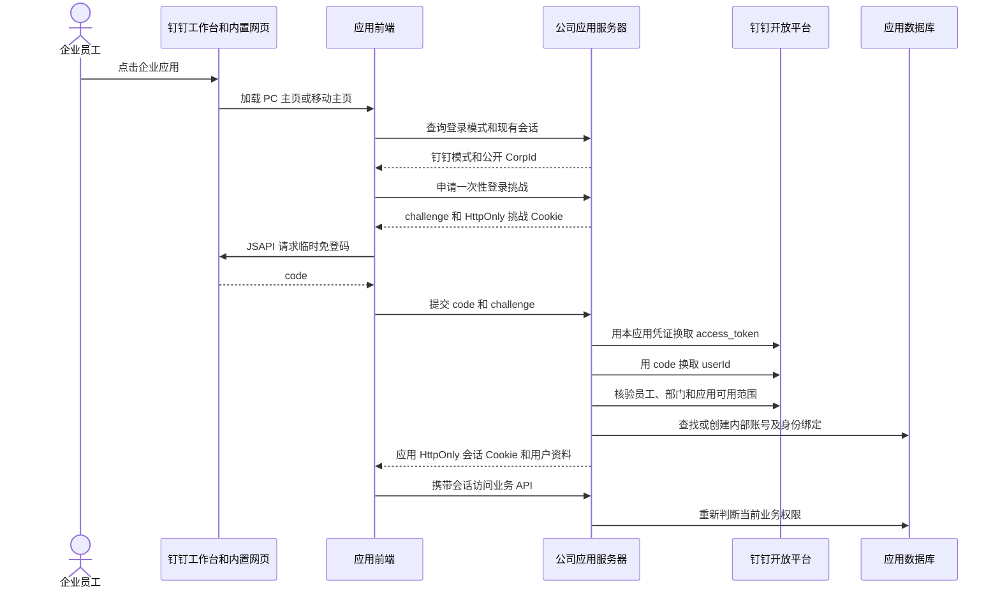

# 企业应用接入钉钉工作台和账号体系复用指南

适用范围：将部署在企业服务器上的网页应用接入同一企业的钉钉工作台，使用员工钉钉身份登录，并保留应用自己的业务权限。本文以 AGICO 企业知识库的实际实现为例，供翻译、订单、设备、项目管理等应用参考。核对日期：2026-10-20。

本项目采用**企业内部 H5 网页应用免登**。网页、API、数据库和后台任务仍由公司服务器运行；钉钉负责展示入口，并提供可由服务器核验的企业员工身份。应用收到身份后建立自己的会话，按自己的权限规则处理业务。

## 1 员工每天如何使用

员工在钉钉中切换到公司组织，进入工作台，点击“AGICO企业知识库”。钉钉内置网页容器加载应用首页；有有效会话时直接进入，没有会话时自动取得临时免登码，再由知识库服务器核验身份。员工无需另外登记知识库密码。

例如，某员工属于已映射的百斯特事业部：首次进入时系统建立该员工的应用账号，默认角色为普通用户；按部门范围读取资料和上传资料。负责人经应用内明确授权后才有审批权。员工转到其他部门后，后台重新核验部门并调整有效范围，不要求重新登记账号。

| 参与者 | 负责什么 |
|---|---|
| 员工 | 在钉钉工作台打开应用，执行业务操作 |
| 企业管理员或应用开发者 | 创建企业应用、设置主页、申请 API 权限、设置可见范围并发布 |
| 应用运维人员 | 部署网页、API、数据库和 worker，管理域名、证书和受保护配置 |
| 业务负责人 | 在应用内分配业务角色、确认资料归属和审批内容 |

钉钉企业管理员、部门主管、应用开发者和知识库业务管理员是不同角色。项目没有把它们自动等同。

## 2 整体链路



这里有三种用途不同的凭证：免登 `code` 用于一次身份交换；钉钉 `access_token` 由服务器调用开放平台使用；应用会话 Cookie 用于员工后续访问业务。它们不能相互替代，也不应一起放进前端存储。

## 3 如何在钉钉内部直接打开

### 3.1 先有可访问的网页

企业 H5 应用的首页是一个 URL，例如 `https://orders.example.com/`。员工设备必须能访问这个地址，服务器必须能访问钉钉开放平台，客户端还需要能加载所用的官方 JSAPI 资源。

私网 IP 只适用于网络可达的电脑或已接入企业网络的设备。手机使用移动数据时不能据此假定可访问。正式部署宜使用固定 HTTPS 域名，分别验证办公网、远程网络和手机网络。

### 3.2 创建并配置企业内部网页应用

进入[钉钉开发者后台](https://open-dev.dingtalk.com/)，选择公司组织，在企业内部应用中创建网页应用或 H5 微应用，填写名称、图标和用途。控制台菜单名称可能随版本变化，应以网页应用能力和字段用途为准。

需要记录并区分：

| 标识 | 用途 | 放在哪里 |
|---|---|---|
| CorpId | 企业组织标识 | 服务端固定配置；前端免登时可使用其公开值 |
| AppKey 或 Client ID | 应用标识 | 服务端；部分新版 JSAPI 也需要其公开值 |
| AppSecret 或 Client Secret | 应用调用开放平台的密钥 | 仅服务端受保护配置 |
| AgentId | 员工可用应用列表中的应用标识 | 服务端检查当前员工能否使用目标应用 |
| unifiedAppId | 开发后台和 DWS 管理应用时的定位标识 | 部署管理记录；不能代替 AgentId 或 AppKey |

在网页应用配置中设置“应用首页地址”和“PC端首页地址”。PC 客户端使用 PC 入口，移动端应配置可在手机实际打开的页面。应用没有独立管理后台时，不必为管理后台地址随意填写网址。

在工作台点击已发布的 H5 应用，钉钉就会通过其网页容器加载配置的页面。首页地址负责“打开哪个页面”；页面中的 JSAPI 和服务端身份交换负责“确认当前员工”。仅把 URL 填进后台不会自动实现账号接入。[官方 H5 示例](https://github.com/open-dingtalk/h5app-auth-demo)也分别演示了主页配置、版本发布和免登实现。

### 3.3 权限 可见范围和发布分别配置

需要同时满足：应用具有所调用 API 的权限、通讯录数据范围能覆盖目标员工和部门、目标员工处于应用可用范围、配置所属版本已发布。

本项目实际采用的只读权限如下：

| 权限标识 | 用途 |
|---|---|
| `qyapi_get_member` | 查询员工详情 |
| `qyapi_get_department_list` | 查询部门树 |
| `qyapi_get_department_member` | 部门成员读取能力；属于本项目既有授权集合 |
| `qyapi_get_microapp_list` | 查询指定员工可用应用，核对目标 AgentId |

其他应用应按自己实际调用的 API 逐项确定权限。当前身份客户端登录和刷新主要调用员工详情、部门树和员工可用应用列表；不应仅因为知识库曾授权四项，就给所有应用照搬四项甚至更多权限。本方案不需要写通讯录、发送消息、考勤或钉钉审批权限。

可见范围先限制在试用人员。创建并发布版本后，再用目标员工进入工作台验收。版本仅创建、等待审核或处于草稿状态，都不能算作发布完成。发布及主页配置的做法可参考[官方示例](https://github.com/open-dingtalk/h5app-auth-demo)。

### 3.4 本项目当前实际配置

2026-10-20 通过 `webapp get` 只读回读：

| 字段 | 回读值 | 含义 |
|---|---|---|
| 应用名称 | AGICO企业知识库 | 当前知识库入口 |
| unifiedAppId | `715f4a83-2929-48a6-a159-2f96e8a0c231` | 仅定位本应用，其他应用必须使用自己的 ID |
| `configured` | `true` | 网页应用配置已存在 |
| `pcHomePageUrl` | `http://172.28.221.66:8766/` | 当前已验收的 PC 私网入口 |
| `homePageUrl` | `https://www.dingtalk.com/` | 当前移动主页占位值，没有指向知识库 |
| `h5PageType` | `pc` | 当前为 PC 配置 |

**当前可确认的是 PC 内打开和真实免登。手机知识库入口尚未配置完成，不能把 PC 成功描述为手机也已接通。** 上面的私网 IP 和占位主页都不能照抄为其他应用的正式入口。本文只记录和解释配置，没有修改应用可见范围、主页或发布版本。

### 3.5 开发人员用 DWS 重复配置

以下为其他应用的占位示例，不会自动操作本知识库：

```powershell
$appId = "REPLACE_WITH_YOUR_UNIFIED_APP_ID"
dws dev app webapp get --unified-app-id $appId --format json
dws dev app webapp config --unified-app-id $appId `
  --homepage-url "https://app.example.com/" `
  --pc-homepage-url "https://app.example.com/" `
  --dry-run --format json
```

先核对预检中的目标应用和两条 URL，再按本组织变更流程提交真实配置，之后重新执行 `webapp get` 验证。应用的页面类型应按需要支持的端设置，不能无依据复制当前试用应用的 `pc`。

权限使用 `dws dev app permission list/add` 查询和申请；版本使用 `dws dev app version create/check-approval/publish/status` 管理。涉及写入时先预检，取得对应变更授权后再提交，并保存本次返回的 versionId；最终核对 `RELEASE` 和目标员工可用性。配置、版本创建、版本发布是不同步骤，不能只根据一次命令返回成功判断已经上线。读取应用详情时也应过滤密钥字段，避免把整份响应贴进说明文档。

## 4 前端如何取得当前钉钉账号

实际代码位于 [portal/dingtalk.js](../../src/agico_kb/portal/dingtalk.js) 和 [portal/account.js](../../src/agico_kb/portal/account.js)。

页面先调用 `GET /v1/auth/settings`。钉钉模式下返回的主要内容为：

```json
{
  "auth_mode": "dingtalk",
  "registration": "dingtalk",
  "corp_id": "ding_REPLACE_WITH_COMPANY_CORP_ID",
  "maintenance_login": false
}
```

前端不取得 AppSecret。项目加载的 SDK 地址是 `https://g.alicdn.com/dingding/dingtalk-jsapi/3.1.0/dingtalk.open.js`，并在 CSP 中放行这个准确的资源前缀。脚本加载有 15 秒超时，免登码请求有 20 秒超时，失败后向员工显示提示并允许重试。

当前已验证实现使用以下接口形态；此片段展示 JSAPI 调用，完整的超时和错误处理请复用源码：

```javascript
dd.ready(() => {
  dd.runtime.permission.requestAuthCode({
    corpId: settings.corp_id,
    onSuccess: result => useCode(result.code),
    onFail: error => showLoginError(error)
  });
});
```

完整前端顺序是：读取登录模式 → 尝试 `GET /v1/auth/me` 复用有效会话 → 会话失效且处于钉钉内时申请 challenge → 请求免登码 → POST 给本应用登录接口 → 更新页面账号和菜单。

浏览器环境判断只用来改善交互，不能证明员工身份。员工 ID、企业、部门或角色都不能靠 URL 参数、User-Agent 或前端传值决定，最终以服务器使用应用凭证向钉钉核验的结果为准。

### SDK 新旧写法要分清

官方当前 JSAPI Explorer 还列有顶层 `dd.requestAuthCode`，其入参包含 `clientId`、`corpId`，回调为 `success`、`fail`。它与本项目使用的 `dd.runtime.permission.requestAuthCode` 调用形态不同。新项目应按选定 SDK 和客户端支持情况选择一套经过验证的写法，不能混用参数或回调名；本项目没有在本文编写过程中切换 SDK。[官方 requestAuthCode 说明](https://open.dingtalk.com/tools/explorer/jsapi?id=11723)

小程序的 `dd.getAuthCode` 是另一个能力接口，不能将其示例直接当作 H5 微应用实现。[官方 getAuthCode 支持矩阵](https://open.dingtalk.com/tools/explorer/jsapi?id=10295)

当前源码没有实施 `dd.config` 签名流程，已验收的免登链路采用上面的接口。若其他应用增加定位、分享等额外 JSAPI，应逐项按对应官方要求决定是否需要签名、可信域名及额外授权，不能据此推断所有 JSAPI 都免签名。

## 5 后端如何核验身份并建立会话

### 5.1 一次性挑战

前端先调用 `POST /v1/auth/dingtalk/challenge`。服务器生成独立随机 challenge 和浏览器随机值，数据库仅保存它们的哈希；浏览器值放进 HttpOnly Cookie，challenge 返回页面。

挑战三分钟到期，使用后失效，绑定同一浏览器。本项目按请求地址累计挑战申请，15 分钟窗口超过 60 次时限流。提交登录时校验来源、challenge 和浏览器 Cookie，再原子标记挑战已使用，之后才去交换免登码。

该挑战是本应用增加的登录保护，不是钉钉免登码，也不是 AppSecret。

### 5.2 服务端调用顺序

[dingtalk_client.py](../../src/agico_kb/dingtalk_client.py) 的当前实现使用如下接口。它们是本项目已实现的接口版本，不代表新项目必须永远选用同一代 API。

| 顺序 | 请求 | 作用 |
|---|---|---|
| 1 | `GET https://oapi.dingtalk.com/gettoken` | 用本应用 AppKey/AppSecret 获取应用 access_token |
| 2 | `POST /topapi/v2/user/getuserinfo`，JSON `{ "code": "..." }` | 将前端临时 code 换成企业内 userId |
| 3 | `POST /topapi/v2/user/get`，JSON `{ "userid": "...", "language": "zh_CN" }` | 读取姓名、激活状态、部门 ID、unionId |
| 4 | `POST /topapi/v2/department/listsub` | 从根部门开始读取并校验部门树 |
| 5 | `GET /microapp/list_by_userid` | 在返回的 `appList[].agentId` 中核对当前应用 |

除取 token 外，以上请求由客户端封装附加 `access_token` 查询参数。token 只在服务端缓存，提前到期刷新；上游明确拒绝缓存 token 时仅刷新重试一次，避免无限重试。HTTP 请求连接超时 5 秒、一般请求超时 10 秒。

员工仍在通讯录里，不代表他仍有权使用本应用。因此步骤 5 不能由步骤 3 代替。项目还检查响应结构和字段类型；上游超时、缺字段或权限错误不会被解释为“全公司员工离职”。

关于 code 交换和员工详情，参见[官方免登码换用户信息](https://open.dingtalk.com/document/orgapp-server/obtain-the-userid-of-a-user-by-using-the-log-free)及[官方用户详情](https://open.dingtalk.com/document/orgapp-server/query-user-details)。

### 5.3 应用仍需要内部账号和会话

身份唯一键为 `(corp_id, user_id)`。显示姓名用于展示，unionId 用于辅助记录，都不代替该唯一键。其他应用可将其绑定到自己的 `user_id`，不需要使用知识库的账号前缀或表名。

首次登录且没有绑定时，知识库创建内部 `principal_id` 和默认普通用户账号，不设置员工本地密码。由于既有表要求 email 字段，项目用哈希构造 `@dingtalk.invalid` 内部占位值；这不是员工真实邮箱，不用于发信，也不用于合并旧账号。新应用若表结构不强制邮箱，可直接保留可空邮箱。

身份核验完成后，服务器产生本应用随机会话，数据库保存会话哈希，并以 `agico_session` Cookie 发给浏览器。浏览器 Cookie 最长八小时，标记 HttpOnly、SameSite=Lax；HTTPS 请求下标记 Secure。后续业务写请求还需携带服务器给本会话生成的 `X-CSRF-Token`。

八小时 Cookie 不代表员工权限八小时不变。身份新鲜度按下节的最长五分钟单独复核。

### 5.4 对外接口契约

| 接口 | 用途 | 核心限制 |
|---|---|---|
| `GET /v1/auth/settings` | 返回登录模式和公开 CorpId | 不返回应用密钥 |
| `POST /v1/auth/dingtalk/challenge` | 申请一次性登录挑战 | 同源检查、浏览器绑定、限流 |
| `POST /v1/auth/dingtalk/login` | 提交 `{code, challenge}` 登录 | 服务器核验企业、员工和应用范围 |
| `GET /v1/auth/me` | 读取当前应用会话 | 仍需核验当前身份和业务状态 |
| `POST /v1/auth/logout` | 退出当前应用会话 | 应用自己的退出操作 |
| `POST /v1/auth/dingtalk/bind` | 绑定已有应用账号 | 有效既有会话、CSRF 和新钉钉身份双重证明 |

端外扫码登录、第三方应用授权、多企业 SaaS 授权不在当前实现中。普通浏览器打开时应提示从公司钉钉进入；要支持其他登录入口，需要另外实现并验收。

## 6 部门和业务权限如何接上

### 6.1 部门映射使用 ID

配置 `department_map`：键为钉钉部门 ID，值为本应用的业务组织 ID 列表。比如演示配置 `"101": ["baiste"]` 表示将示例钉钉部门 101 及其下级部门映射到知识库百斯特事业部。这里的 101 是示例，部署时必须使用实际查询并确认的 ID。

当前实现会从员工所在部门沿父部门向上查找映射；员工多部门任职时取映射并集。把企业根部门映射到敏感业务组织可能让大量下级员工获得访问范围，应逐项确认映射覆盖面。

项目没有靠部门名称相似进行自动匹配，也没有根据文件名中的事业部字样授予权限。

### 6.2 权限由部门范围和业务角色共同决定

| 应用角色 | 代码值 | 权限来源 |
|---|---|---|
| 普通用户 | `user` | 首次钉钉登录默认角色；在有效部门范围内使用业务功能 |
| 资料管理员 | `manager` | 应用内明确授权；审批范围还需与当前有效部门范围相交 |
| 开发人员 | `superadmin` | 应用内明确授权的最高权限；不从钉钉管理员身份推导 |

知识库还给已核验员工两类默认公共读取范围：`general-group`、`company-common`。这是知识库自己的业务规则，其他应用不应照抄为默认“所有数据可读”。

后端统一生成 `Principal`，上传、列表、搜索、下载、预览、缩略图、审批和 MCP 都检查它。前端隐藏菜单只负责展示，不能代替接口权限检查。

### 6.3 调部门和撤销应用权限如何生效

`refresh_seconds` 可设为 30–300 秒，当前默认 300 秒。请求发现身份过期时重新查询员工、部门和应用可用性；API 还有每 30 秒唤醒的后台核对循环，每轮选择最多 100 个已过期的已绑定账号。

因此本实现是“请求时复核加定期核对”，没有实现通讯录事件订阅，也不保证在改部门的同一毫秒撤销访问。正常情况下身份有效性最长缓存五分钟；后台处理大量账号的速度还受接口耗时影响，请求路径仍执行新鲜度判断。

明确员工移除、失去应用可用权限或激活状态不可用时，项目撤销相关网页会话、OAuth 授权和未使用授权码。上游故障时，过期身份不能继续访问，也不自动退回普通员工密码登录；有效缓存到期前按其原有期限使用，不延长新鲜度。

这套逻辑只刷新已绑定的应用用户，并非把整家公司所有人员预先注册进应用。实际迁移或新增成员通常在首次进入时创建绑定。

## 7 已有账号如何保留和迁移

已有账号的 principal_id、密码哈希、角色、上传历史和审计要保留。禁止按同名、同邮箱或手机号相似自动接管账号；同一钉钉身份也不能绑定多个内部账号。

绑定接口要求同时证明“当前已登录的旧应用账号”和“当前钉钉员工身份”，并在远程核验返回后再检查旧会话仍有效。测试已覆盖绑定不改变原 principal_id 和密码哈希、会话中途失效拒绝绑定。

**当前可用的既有账号自助绑定路径主要是受控运维账号：** 钉钉模式启用后，未绑定的普通历史员工不能再用原密码登录；只有显式列入 `maintenance_principals` 的有效 `superadmin` 可以使用本地运维入口。项目没有交付普通历史员工批量迁移或管理员任意代绑的通用界面。其他已有应用迁移时，应单独设计和验收旧员工身份核对流程，不能把这个 `/bind` 接口描述成全部旧账号已自动迁移，更不能临时把普通员工提升为最高权限来完成绑定。

`maintenance_principals` 填应用已有的内部 principal_id，不填邮箱、钉钉 userId 或企业 CorpId。只用于受控维护账号。钉钉模式下，普通员工的密码登录、邀请激活和密码重置从前端和后端同时关闭，避免旧路径绕过钉钉身份状态。

## 8 可复用配置与部署

### 8.1 配置模板

示例文件：

- [dingtalk.config.example.json](examples/dingtalk.config.example.json)：字段结构和演示部门映射，无真实密钥。
- [dingtalk.runtime.patch.example.json](examples/dingtalk.runtime.patch.example.json)：需要合并进完整运行配置的字段。

`AGICO_KB_DINGTALK_CONFIG_FILE` 指向受保护的钉钉配置文件。设置该变量才启用钉钉模式；仅把文件放进安装包不会自动切换现有实例。

示例运行文件是**字段补丁，不是完整 runtime.json**。应读取既有 JSON、修改对应字段，再覆盖写回完整 JSON；不要用补丁文件替换现有配置而丢失数据库、原件、模型或 provider 设置。

正式目标采用固定 HTTPS 域名。设置 `PUBLIC_URL` 和相应主机范围，并配置反向代理、证书和真实可信代理来源。项目 `AGICO_KB_ALLOWED_HOSTS` 主要用于 MCP 主机检查，不能代替反向代理防火墙或应用身份授权。

反向代理需正确传递 Host 和 HTTPS 协议，应用只信任实际代理 IP；否则同源比较或 Cookie Secure 判断会失真。CSRF 的来源基准是服务器识别出的请求基址，不是仅凭 `PUBLIC_URL` 字符串就能修好。

### 8.2 凭据管理

配置文件只允许对应运行身份读取，由受控运维写入。Windows 正式服务使用项目的受保护配置和服务 ACL 流程；当前独立试用任务以 SYSTEM 运行，配置仅允许 SYSTEM 和 Administrators 访问。Linux 部署可采用独立运行身份和等效最小文件权限。

不要把真实 AppSecret 写进前端、示例文件、Git、命令行参数或普通日志。旧版接口在 URL 查询参数中携带凭据，HTTP 日志也必须脱敏。本项目客户端已对 HTTPX INFO 日志中的钉钉查询参数做过滤。

项目支持由开发机 DWS 凭据导入受保护配置：

```powershell
.\.venv\Scripts\python.exe .\scripts\dingtalk-setup.py import-cli `
  --app-id "REPLACE_UNIFIED_APP_ID" `
  --corp-id "REPLACE_CORP_ID" `
  --agent-id "REPLACE_AGENT_ID" `
  --config "D:\ProtectedAppConfig\dingtalk.json"
```

这是本项目运维工具；服务器运行时使用企业应用自身凭据，不依赖开发人员的 DWS 登录会话持续在线。已存在的配置不会被导入工具静默覆盖。

验证配置和只读探测：

```powershell
.\.venv\Scripts\python.exe .\scripts\dingtalk-setup.py validate --config "D:\ProtectedAppConfig\dingtalk.json"
.\.venv\Scripts\python.exe .\scripts\dingtalk-setup.py probe --config "D:\ProtectedAppConfig\dingtalk.json"
```

`probe` 只证明部门 API 可读，输出明确将 `client_login_verified` 置为 false；它不等于员工在真实钉钉中已经免登。

### 8.3 业务后台必须与 API 配套部署

知识库包括数据库、API、worker。独立测试实例必须有自己的 worker，并与 API 使用同一数据库、schema、原件目录和对应源码；子进程还需继承正确的配置和 `PYTHONPATH`。

本项目当前 PC 试用实例为 `C:\AGICO-DingTalk-Test-20261019`，API 端口 8766，独立数据库 `agico_dingtalk_test_20261019`；后台任务为 `AgicoKbDingTalkWorker`，配置开机启动、单实例、异常重启和无限执行时限。原 `AgicoKbWorker` 服务运行并不表示它会消费这个独立数据库。

可参考 [run-instance-worker.py](../../deploy/windows/run-instance-worker.py) 的显式配置启动方式和 [worker 修复记录](../validation/dingtalk-worker-20261020.md)。翻译应用应部署对应翻译队列，订单应用应部署必要的异步任务；其是否需要 worker 由实际业务决定，不能只复制知识库的任务名称。

### 8.4 切换已有正式应用

先备份切换前最新数据库、原件及受保护配置，保留员工身份与业务关系。在隔离副本验证迁移和绑定，再按维护流程切换。知识库的迁移 007 增加身份绑定表、挑战表及会话认证来源，不重置原密码或账号；已存在正式账号时禁止重新 bootstrap。

换服务器或域名时，应一起核对应用数据、CorpId/userId 绑定、运行配置、主页/PC主页、相关域名和代理设置。已有会话可能需要重新登录，AI 客户端可能需要重新授权；这些不能作为清空账号重建的理由。

## 9 其他应用具体复用什么

| 知识库实现 | 可复用部分 | 移植时需要替换 |
|---|---|---|
| [dingtalk_client.py](../../src/agico_kb/dingtalk_client.py) | token 缓存、code 交换、员工/部门/应用可用性读取、受控错误和日志过滤 | 应用配置、业务组织校验；当前配置校验依赖知识库 taxonomy |
| [portal/dingtalk.js](../../src/agico_kb/portal/dingtalk.js) | SDK 加载、环境提示、超时、challenge/code 提交 | 应用提示文案、接口路径和选定的 SDK 版本 |
| [dingtalk_login.py](../../src/agico_kb/dingtalk_login.py) | 一次性挑战、浏览器绑定、登录交换、双重证明绑定流程 | 账号仓储、会话响应、CSRF、中间件接线 |
| [dingtalk_identity.py](../../src/agico_kb/dingtalk_identity.py) | 企业员工唯一键、部门祖先映射、有效期复核、并发更新保护和撤权思路 | 内部用户表、业务角色、部门范围、公共读取规则 |
| [accounts.py](../../src/agico_kb/accounts.py) 和 [auth.py](../../src/agico_kb/auth.py) | HttpOnly 会话、哈希存储、CSRF、统一身份加载 | 既有应用自己的用户/会话实现，不必复制知识库所有账号功能 |
| [007_dingtalk.sql](../../src/agico_kb/migrations/007_dingtalk.sql) | 身份唯一约束、挑战过期和认证来源设计 | 表名、外键和既有迁移机制 |
| [account_oauth.py](../../src/agico_kb/account_oauth.py) | 网页与 AI/MCP 共用身份复核及撤权 | 仅接入网页的应用不需要复制 MCP OAuth |

这些文件目前是项目内部模块，依赖现有账号、错误类型、数据库和业务分类，尚不是一个独立安装包。移植重点是保留协议和权限边界，并对接目标应用的用户仓储；只复制一个文件不能得到完整账号系统。

最小迁移顺序：先部署可访问的网页/API → 创建本应用的 H5 应用 → 配置主页、只读权限和试用范围 → 建立 `(CorpId,userId)` 绑定与应用会话 → 接入前端免登 → 加上业务部门和角色检查 → 配套异步任务 → 真实客户端验收 → 再扩大范围。

多个独立业务应用通常各自申请 AppKey/AppSecret 和 AgentId，CorpId 可以属于同一企业。这样应用可见范围和密钥可分别管理；不要把本知识库的密钥复制给其他应用。若以后建设统一身份网关，应另行设计 token 受众、应用间授权和撤销机制；当前项目没有交付公司级统一 SSO 网关。

## 10 接入验收和常见问题

### 10.1 验收至少走完这些场景

1. 目标员工在真实钉钉 PC 工作台看到应用，并在内置页面打开正确 URL。
2. 手机端单独检查主页、网络和免登；PC 通过不代替手机通过。
3. 首次登录无需新增员工密码；退出、过期、刷新和重开可按预期恢复。
4. 姓名重复、无真实邮箱、多部门和未映射部门均不能造成错误合并或越权。
5. 普通用户无管理员接口权限，主管身份也不自动提升角色。
6. 调部门、员工不可用和移出应用范围后，网页和 AI/MCP 访问随复核失效。
7. 钉钉 API 超时、token 失效和权限不足时，错误可见、重试有界，不能放开所有人权限。
8. 对每个异步应用，用全新隔离资料验证提交、自动消费、处理完成和实际业务输出。测试记录须有“测试数据”和批次标记，不混入正式资料或统计。
9. 验证对应服务自动启动、故障重启、正确配置来源，以及备份恢复后账号和身份关系仍在。
10. 保存实际客户端、服务端和任务结果证据，明确尚未覆盖的设备、网络和业务范围。

### 10.2 症状和排查顺序

| 症状 | 优先检查 |
|---|---|
| 工作台没有图标 | 是否在正确公司、员工可见范围、应用是否启用、版本是否已发布 |
| 点击后进外部浏览器或页面不对 | 网页应用类型、PC/移动主页和实际页面打开方式；不能只看一条聊天链接 |
| PC 能开 手机不能开 | 手机主页是否仍为占位地址、私网地址是否可达、移动布局及 SDK 支持 |
| 取得 code 但登录失败 | 企业和应用凭证是否一致、挑战 Cookie/有效期、code 是否被重复使用、员工和应用可用范围 |
| 登录成功但看不到资料 | 部门 ID/祖先映射、应用业务角色、发布状态；不要直接提高为最高权限 |
| 普通浏览器不能自动免登 | 该实现依赖钉钉容器；端外扫码登录需单独实现 |
| 上传按钮无反应 | 浏览器异常和 HTTP 安全上下文能力；本项目已改用 HTTP 下可用的安全随机数生成上传标识 |
| 已提交但一直命名中 | 相同数据库的 worker 是否运行、AI provider 是否配置、任务尝试次数是否推进 |
| 显示命名待核对 | 命名证据不足，负责人确认后才按既有规则开始解析 |
| 旧 Office 一直处理中 | 转换子进程、超时和备用解析；部分解析不应伪装为完整处理 |
| HTTPS 下 Cookie 或 CSRF 异常 | 代理传入的 Host/协议、可信代理范围、同源请求和 Cookie 属性 |

HTTP 内网环境尤其需要单独验收：本项目曾因 `crypto.randomUUID()` 在非安全上下文不可用，导致上传在发送请求之前中断。现在使用 `crypto.getRandomValues()` 生成上传标识，并捕获准备阶段错误。正式 HTTPS 仍应独立验收，不能把内网兼容补丁当成域名和 TLS 已完成。[上传修复记录](../validation/dingtalk-http-upload-20261020.md)

## 11 源码入口和进一步阅读

- 设计与边界：[钉钉身份接入设计](../design/dingtalk-identity.md)。其中事件加速、正式迁移等设计意图，应结合本文和实际源码判断完成范围。
- 已验收和未验收范围：[钉钉身份验证记录](../validation/dingtalk-identity-20261019.md)。
- 配置与正式部署：[服务器安装说明](../server-setup.md#钉钉身份模式可选先在独立实例验收)。
- 身份与绑定测试：[test_dingtalk_identity.py](../../tests/integration/test_dingtalk_identity.py)。
- 客户端协议测试：[test_dingtalk_client.py](../../tests/unit/test_dingtalk_client.py)。
- 官方 H5 接入实现参考：[open-dingtalk/h5app-auth-demo](https://github.com/open-dingtalk/h5app-auth-demo)。示例中的密钥演示方式不代替本项目的受保护凭据要求。
- 当前官方 JSAPI：[requestAuthCode](https://open.dingtalk.com/tools/explorer/jsapi?id=11723)，[H5 免登流程](https://open.dingtalk.com/document/orgapp-client/logon-free-process)。
