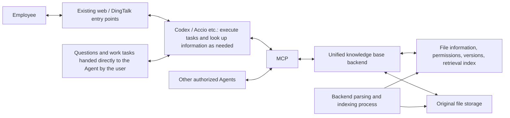

# Enterprise Knowledge Base Project Design Baseline

Update date: 2026-09-15. This document consolidates the handover documentation and the requirements confirmed in this task, serving as the project basis for the development plan. Steps 0–5 have completed development and local synthetic verification, and steps 6–8 are being implemented; see the development plan and validation reports for the actual components and verification boundaries. This does not represent official launch or completion of business acceptance.

## 1. Goals and Principles

Build a unified enterprise file and knowledge base on company servers, serving the following two categories of needs:

1. Additional enterprise knowledge extension packs for AI/Agents such as Codex and Accio: enable the Agent, when answering questions and carrying out various work tasks, to understand the company's organizational business, products, work standards, communication requirements, and historical experience, and to form company-aligned judgments, answers, and deliverables accordingly. The Agent retrieves and applies this knowledge on demand via MCP; task understanding, judgment, computation, and delivery are handled by the original Agent.
2. Employees' use of materials: upload files through the existing web/DingTalk entry points, search for materials, ask questions about content, and retrieve complete files.

Keep the design simple, efficient, and reasonable; do not over-engineer. Complete an actual closed loop first, then optimize based on identified problems. Take token consumption into account by using relevant fragments and on-demand reading; do not set strict, fixed per-task token quotas.

General working process: the Agent receives a question or task → identifies the company background, facts, standards, or experience it needs to know → retrieves the relevant knowledge via MCP → understands its scope of applicability and applies it to answers, judgments, and execution steps → continues to produce results that meet company needs. This capability applies across all kinds of work scenarios; historical quotations are merely an illustrative example and do not constitute the product positioning or a dedicated main workflow.

What users call "tuning the AI" is realized in this project as providing enterprise knowledge and work requirements so that the Agent's behavior and outputs align better with the company; the first version is implemented through external knowledge and adaptation conventions, not premised on model training. The goal is for the Agent to work with enterprise knowledge like an employee who knows the company; the actual degree of understanding is based on the knowledge already ingested and task verification results, with no promise of automatically mastering all materials once connected.

The "enterprise knowledge extension pack" consists of a unified materials repository, MCP capabilities, and brief usage conventions; the packaging form is determined by client support and does not presuppose developing any particular proprietary plugin. The usage conventions have the Agent proactively consult the repository whenever company background, facts, standards, or experience are needed, and apply the retrieved knowledge to the current task; it does not rely on employees explicitly saying "search the knowledge base" every time. Relevant enterprise context is retrieved on demand; there is no requirement to repeatedly load or scan the entire repository each time, nor an assumption that merely connecting to MCP means the Agent automatically knows when to query.
## 2. Confirmed Architecture

The linkage between the entry points and the Agent is stated by the user to be already implemented; the implementation has not yet been reviewed, nor has its operation been verified. The entry points, the Agent, and the server are not assumed to be in the same location.

The first version starts with one backend application and one separate backend processing process; MCP is the access method to the same backend. Model answers and task execution remain the responsibility of the existing Agent. Backend parsing, OCR, vectorization, and indexing are fixed tasks; no dedicated ingestion Agent is set up.

## 3. Feature Scope

| Scope | First-version requirements |
|---|---|
| File management | Save original files first, queryable status, permission-based file retrieval, classification and associated information |
| Content retrieval | Hybrid keyword and vector retrieval; filtering by organization, model, product, file, version, and permissions |
| Reading | Relevant passages, sections, tables, and source locations; fetch more content as needed |
| Enterprise knowledge augmentation | Understand company background on demand, consult facts, apply specifications and templates, and reference past experience, so that answers and task results meet company requirements |
| Publishing and versioning | Free submission, authorized publication; submit a replacement draft after local editing; conflict checking; traceable history |
| Takedown and restoration | Stop official retrieval and normal downloads, while retaining authorized historical traceability and the ability to restore |
| Basic operation | Retry on processing failure, service recovery, logs, and independent backup and restore verification |
| Agent adaptation | Trusted identity, file handoff, MCP compatibility, result return, and a brief usage agreement |

Reuse the existing web page, DingTalk, and Agent; do not build a separate chat application or a full employee website. Do not develop collaborative editing, blockchain, all-device synchronization, knowledge graphs, automatic multi-level summarization, model fine-tuning, or cluster scheduling systems.

## 4. Classification
Use the [Knowledge Base Classification Scheme](knowledge-base-classification.md) as the basis for classification configuration. 8 sections: Tongyong International Group, Baisite Business Division, Xingyuan Business Division, Baichuang Business Division, Aijike Business Division, Jimuke Business Division, Market Intelligence Center, Company Public Knowledge.

6 purpose categories: Organization & Business Context, Product & Technical Materials, Project & Customer Materials, Process Standards & Templates, Experience Cases & FAQs, Other Materials.

Keep the two levels of organization and purpose, with product / project / model / format serving as filter options. Cross-department sharing uses the same file record and versions; do not duplicate into multiple knowledge bases. A department name is not an access permission; "public knowledge" also requires authorization.

## 5. Data and Processing Principles

- The original file is the source of truth; parsing results and indexes can be rebuilt. Files are saved first, then parsed and vectorized in the background.
- Processing status and publication status are kept separate; successful upload, completed processing, and official searchability must not be conflated.
- Parsing or vectorization failures must not lose files; the system clearly marks the scope of what is searchable and readable.
- Regular text and tables in PDF, Word, Excel, and PPT are verified first; for CAD / 3D, save the complete file or model package first and link supporting materials, without claiming the ability to verify geometric information.
- Citations are bound to specific versions and source locations. When no reliable page number exists, use real locations such as sections / tables; do not fabricate page numbers.
- Historical business records and old versions of the same file are handled separately: records from different times and projects may each participate in retrieval as official historical materials; the file's version rules apply only when the same record is revised. Relevant historical experience must not be excluded merely by upload time or "latest" sorting.
- When returning knowledge, preserve the original conditions such as date, applicable product / business, prerequisites, and limitations. Distinguish current specifications, factual basis, and historical reference; a published historical case does not automatically become a current execution requirement. Scenario-specific information follows the original text and common association fields; do not add dedicated business databases for examples.
- Replacement or removal affects normal retrieval, reading, and file delivery; when submitting an old draft, take care to prevent it from overwriting the new version.
- Business owners are responsible for content publication, and IT is responsible for operations and maintenance; an O&M role does not automatically confer business publication rights.
- Employee or service identity comes from the authentication chain; the backend must not trust names, departments, or roles filled in by the model.
- Cloud models may receive retrieved content; local storage does not mean all data stays inside the intranet. Define the allowed data flows explicitly at integration time; the first round of component trials uses local models and synthetic data by default.

## 6. Efficiency

Files are parsed and indexed in advance; when a file or document number is explicitly specified, locate it directly; search returns a small number of relevant fragments and sources, which can be expanded when needed. Metadata filtering, sorting, and deduplication are handled by the backend.
Verify "the Agent proactively retrieves and applies enterprise knowledge in question answering and work tasks": check both whether supporting evidence is found and whether company background, norms, terminology, and experience actually improve judgments and deliverables. The actual capability is provided jointly by MCP and a brief usage convention, while business processes continue to be executed by the original Agent.

For now, do not introduce additional answer caching, a standalone reranking model, or fine-grained token budgets. Decide on optimizations only after observing, on real tasks, evidence accuracy, cumulative token usage, tool calls, and elapsed time. Repeated history consumption in model input is controlled with the cooperation of the existing Agent; no expanded commitments are made about MCP capabilities.

## 7. Capacity and Acceptance

The first phase supports 20–50 Agents reading concurrently and is validated at 50; the mid and later phases scale up and are validated at 200. The first-phase baseline is counted as one search or read request per Agent at any given moment; actual invocation behavior is corrected after integration.

Retrieval by Agents behind the browser/DingTalk counts toward the same total load. Query latency and model generation latency are recorded separately, and large-file transfer is covered by unit tests. 50/200 are targets, not yet tested, and are not capacity commitments.

Core business acceptance selects a small number of representative questions and tasks from the company's actual work, covering "background understanding, factual lookup, norm application, and experience reference"; it checks whether Codex/Accio proactively retrieves appropriate knowledge, understands applicable conditions, and makes answers, execution steps, and deliverables conform to company requirements; call volume and token consumption are observed at the same time. Specific cases can be replaced; historical quotations are just one possibility. Employee file usage capability is accepted separately.

Technical acceptance covers real files, fresh imports, permission isolation, official versions, takedown, conflicts, retry on parsing failure, batch import running in parallel with queries, restart after disconnection, and independent recovery. Hardware, QPS, response time, and availability thresholds form the acceptance configuration in the initial stage based on actual conditions; testing against an empty database on an arbitrary machine is not an acceptable substitute.

## 8. Pre-Development Inputs and How They Are Handled

The user has confirmed that the server system is Windows and the configuration is sufficient; the main clients are Codex and Accio. The specific Windows version, CPU/memory/disk/GPU, client versions and authentication methods, real file samples, and corpus scale are recorded during the implementation phase. The current development computer is not automatically treated as the target server.

The first version is designed as a native Windows background service; Docker Desktop, WSL, or an operating-system change is not adopted by default. The above missing items do not prevent writing the development plan or validating with synthetic samples, but they do prevent drawing conclusions that real-server compatibility, real business quality, real identity connectivity, or the 50/200 capacity target has been achieved. Delivery evidence is defined separately for technical verification and real integration.
## 9. Sources

- Original project handover materials: kept offline by the project lead; this repository defers to the current design and development plan.
- Subsequent user confirmations during this task: prioritize simplicity; the backend is responsible for parsing and vectorization; organization categories determined according to screenshots; prepare the development plan.
- The original handover document is retained as a historical source. Future updates to this project will be integrated directly into this baseline and related plans, rather than appending mutually contradictory conclusions.
